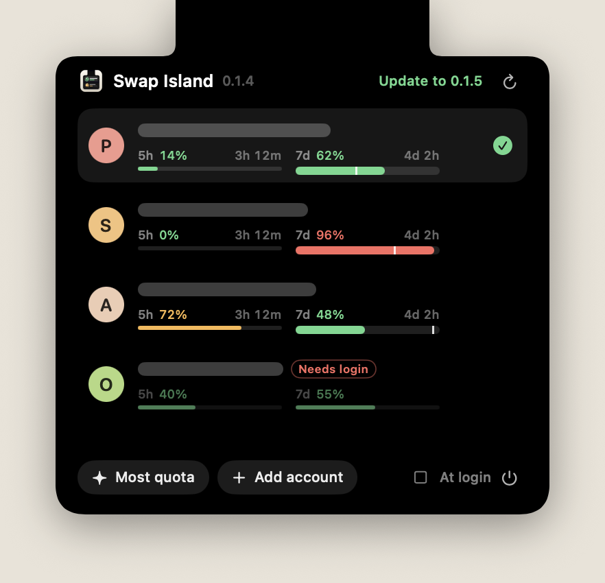
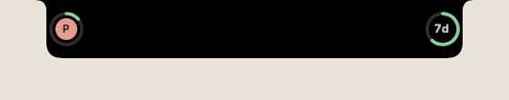
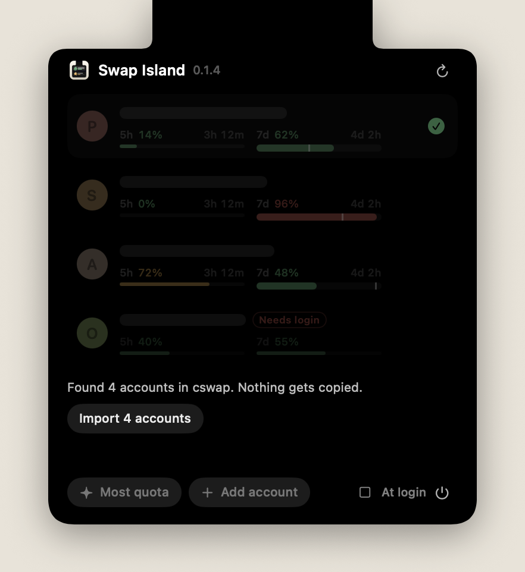

# Swap Island

Switch Claude Code accounts from the MacBook notch. Move the pointer to the notch, read the 5-hour and 7-day usage of every account, and click an account to switch to it.

<p align="center">
  
</p>

When the panel is closed, Swap Island adds one small wing on each side of the notch. The left wing shows the badge of the active account inside a ring for its 5-hour usage. The right wing shows a ring for its 7-day usage. The open panel folds both wings away and sits below the menu bar, so it covers no menu bar icons. The app reads the notch position from macOS, so the alignment follows each MacBook model and display scale.

<p align="center">
  
</p>

The screenshots use demo data, with the addresses covered.

Swap Island is a SwiftUI app on top of [claude-swap](https://github.com/realiti4/claude-swap). It never reads or writes credentials. Every action runs the `cswap` command, and `cswap` holds the Claude Code credential locks while it writes.

## Install

You need macOS 14 or later. Run this command in Terminal:

```bash
curl -fsSL https://raw.githubusercontent.com/liberators-ai/swap-island/main/install.sh | bash
```

The script verifies the SHA-256 checksum of the download and installs the app in `/Applications`. If `/Applications` is not writable, it uses `~/Applications`. If `cswap` is missing, the script installs it with `uv` or `pipx`.

To install without Terminal, download [Swap-Island.dmg](https://github.com/liberators-ai/swap-island/releases/latest/download/Swap-Island.dmg) and drag the app to Applications. The app is not notarized, so macOS blocks the first launch. To allow it:

1. Open the app and close the warning.
2. Open **System Settings > Privacy & Security**.
3. Click **Open Anyway**.

If you installed from the DMG, install `cswap` yourself with `uv tool install claude-swap`. Swap Island shows this command when it cannot find `cswap`.

## Use it

The first launch opens the panel and asks you to import your accounts. Accounts that are already in `cswap` appear in the list, and **Import** turns them on without copying anything. If `cswap` has no accounts, click **Import current login** to save the login that Claude Code uses now.

<p align="center">
  
</p>

To open the panel, move the pointer to the notch or click the Swap Island icon in the menu bar. The icon keeps the panel open until you click it again.

| To do this | Do this |
|---|---|
| Switch to an account | Click its row. The switch happens at once, with no confirmation. |
| Switch to the account with the most quota | Click **Most quota**. |
| Add an account | Click **Add account**, log in, and save the login. |
| Pause or resume an account | Hover over its row and click the pause or play button. |
| Remove an account | Hover over its row and click the trash button twice. |
| Start the app when you log in | Select **At login**. |
| Quit | Click the power button. |

Running Claude Code sessions pick up a switch in about 30 seconds.

## Updates

Swap Island checks the GitHub releases when it starts and every 6 hours. It downloads a new version, verifies its SHA-256 checksum, and replaces itself the next time the panel is closed. The panel header shows the installed version and an **Update to** button while an update waits.

Only a copy in `/Applications` or `~/Applications` updates itself. Any other copy shows the button, and the button opens the release page.

To install updates only when you click the button, run this command:

```bash
defaults write ai.liberators.swapisland autoUpdate -bool false
```

## Read the bars

Bars turn amber at 70% and red at 90%. The white tick on a 7-day bar marks even pace. A bar past the tick is using quota faster than the week allows.

## Known limits

- The app has an ad-hoc signature and no notarization.
- To stay out of the three-finger Space swipe animation, the app uses private macOS window APIs. For that reason it cannot ship on the App Store, and a macOS update can break it.
- While the panel is closed, each wing covers 28 points of the menu bar. If your status icons reach the notch, the right wing covers the first icon. In an app with very long menus, the left wing can cover the end of the last menu.
- We tested the app on one MacBook with a notch, on macOS 26.5. Unit tests cover other notch sizes and screens without a notch, which get an island at the top center.
- The updater checks a SHA-256 checksum from the same release, and the app has no Developer ID signature. So anyone who can publish a release in this repository can ship code to every copy that updates itself.

Swap Island is not affiliated with Anthropic. You are responsible for following the Anthropic terms that apply to your accounts.

## Build from source

You need Xcode 16 or later.

```bash
swift test
./scripts/bundle.sh
open "build/Swap Island.app"
```

`scripts/package.sh` also makes the DMG, the zip, and their checksums in `dist/`.

To run the app without real accounts, point it at the stand-in command. Add `SWAP_ISLAND_HIDE_EMAILS=1` to cover the addresses.

```bash
SWAP_ISLAND_CSWAP="$PWD/scripts/fake-cswap.sh" "build/Swap Island.app/Contents/MacOS/SwapIsland"
```

## Credits

[claude-swap](https://github.com/realiti4/claude-swap) does all the account work. The private Space technique comes from [boring.notch](https://github.com/TheBoredTeam/boring.notch).

## License

MIT
